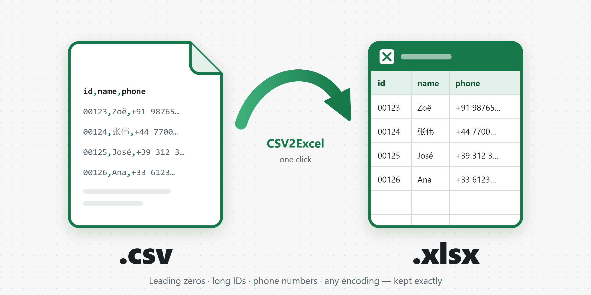
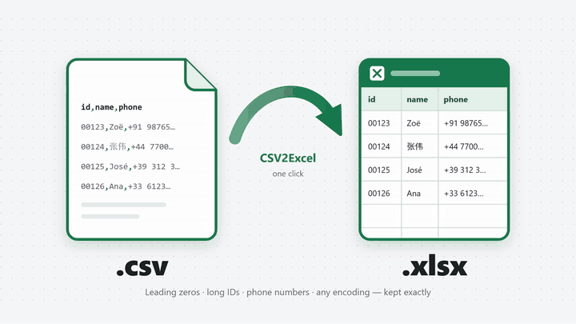
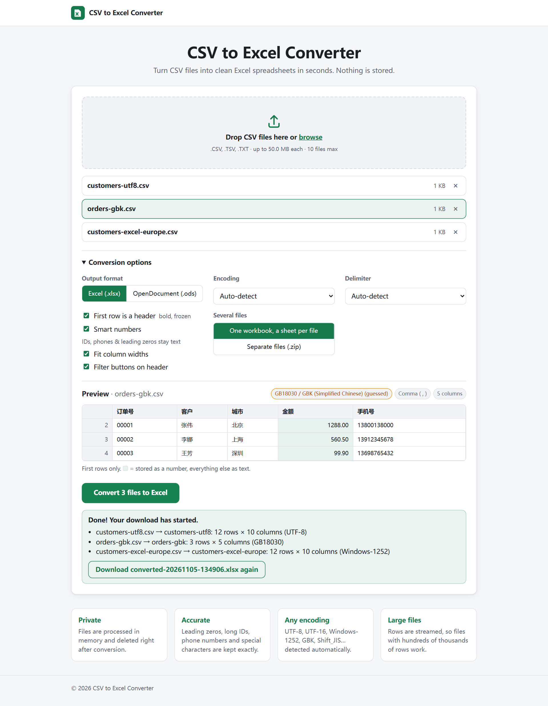
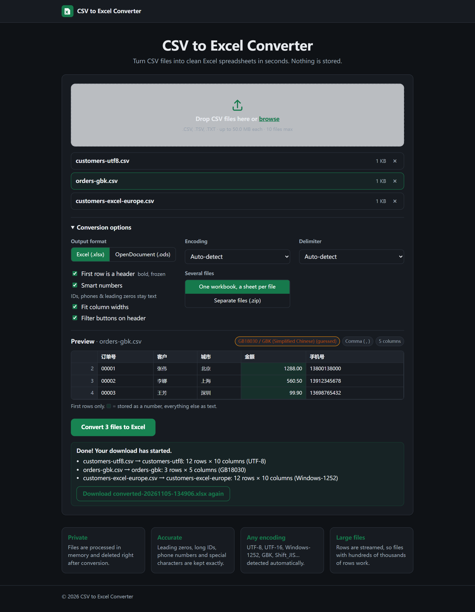
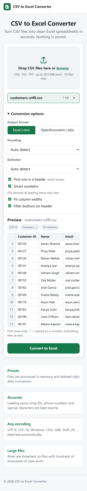

# CSV2Excel

[](https://github.com/Wisper-beep/csv2excel/actions/workflows/ci.yml)
[](composer.json)
[](LICENSE)

A self-hosted **CSV to Excel converter** for PHP. Upload CSV files, preview them, and download a clean `.xlsx` (or `.ods`). The converter gets the data right: leading zeros, long IDs, phone numbers and accented or CJK characters all come through unchanged.

## Demo



▶ **[Watch the full-quality video (MP4, 80 s)](docs/demo.mp4)**. In it, four classic problem files are first opened the way Excel's default import does it (simulated), then converted with CSV2Excel. The "after" grids in the video show the real values read back from the generated `.xlsx`.

## Why this one?

Most "CSV to Excel" scripts just call `fgetcsv` and write cells. On real-world files that goes wrong in several ways:

| Problem with naive converters | What CSV2Excel does |
|---|---|
| `00123` becomes `123`, `+91 98765 43210` loses its `+` | **Column-aware typing.** A column with leading zeros, `+` prefixes or >15 digits stays text as a whole. Headers such as *ID, Phone, ZIP, SKU, Card, 手机, 编号* are recognised too. |
| `4111111111111111` becomes `4.11111E+15` | Values Excel would round (more than 15 significant digits) are kept as text. |
| `Zoë`, `São Paulo` and `张三` come out as `Zoë` or `???` | **Encoding detection.** BOM, UTF-8, UTF-16 ("Unicode Text" from Excel), Windows-1252, GBK/GB18030 and Shift_JIS are detected. Ten more encodings can be chosen manually. |
| European `;` files land in one column | **Delimiter detection** (`,` `;` tab `\|`), quote-aware. |
| `=HYPERLINK(...)` or `=cmd\|...` runs as a formula | Formula-looking values are always written as **plain text**, which blocks CSV injection. |
| Large files hit `memory_limit` | **Streaming.** 500,000 rows convert in about 4 MB of RAM. |
| More than 1,048,576 rows is silently truncated | Rows continue on `Sheet (2)`, `Sheet (3)`, ... with the header repeated. |

Every converted file also gets a bold, frozen header row, filter buttons, and column widths fitted to the whole file (not just the first rows).

### Try it on the problem files

[`examples/problem-files/`](examples/problem-files) has nine classic files that break in Excel: leading zeros, 16-digit card numbers, phone numbers, a Windows-1252 European export, Chinese GBK, UTF-16 "Unicode Text", multi-line fields, formula injection, and gene names that turn into dates. [Their README](examples/problem-files/README.md) explains each one.

```bash
php bin/csv2excel examples/problem-files/0* -o problem-files.xlsx
```

`tests/ProblemFilesTest.php` checks every file on each push. The [CI run](https://github.com/Wisper-beep/csv2excel/actions/workflows/ci.yml) uploads the converted workbook as an artifact, so you can download it and open it in Excel yourself.

## Features

- Drag-and-drop web UI. Works on phones and supports dark mode. No build step and no external CDNs.
- A live **preview** of the first rows, with numeric cells highlighted, so you can see what Excel will get.
- **Several files at once.** Get one workbook with a sheet per file, or a ZIP of separate workbooks.
- Output as **XLSX** (Excel) or **ODS** (LibreOffice).
- **White-label.** Set the name, tagline, logo, colour and footer in a single config file.
- **Secure by default.** CSRF protection, extension and content checks, size limits and a strict CSP. Uploads and outputs are deleted as soon as the response is sent.
- **CLI** for scripts and cron jobs: `bin/csv2excel data.csv`
- Runs on plain shared hosting (cPanel/Plesk). There is no database, no Node and no URL rewriting required.

| Converted | Dark mode | Mobile |
|---|---|---|
|  |  |  |

## Requirements

- PHP **8.3+** with `mbstring` and `zip` (both enabled on virtually every host)
- Composer, unless you use the release ZIP, which already contains `vendor/`

## Installation

### Option A: Shared hosting (no Composer)

1. Download `csv2excel-vX.Y.Z.zip` from the [Releases](../../releases) page.
2. Upload and extract it, for example to `public_html/converter/`.
3. Open `https://your-domain.com/converter/`.

The bundled `.htaccess` serves everything from `public/` and blocks access to the source and config. If you can, point the (sub)domain's document root straight to `public/` instead.

### Option B: With Composer

```bash
git clone https://github.com/Wisper-beep/csv2excel.git
cd csv2excel
composer install --no-dev
composer serve            # http://localhost:8000
```

In production, point your web server's document root to `public/`.

### Option C: Docker

```bash
docker build -t csv2excel .
docker run -p 8080:80 csv2excel
```

### nginx

```nginx
root /var/www/csv2excel/public;
index index.php;
client_max_body_size 60m;
location / { try_files $uri /index.php$is_args$args; }
location ~ \.php$ { include fastcgi_params; fastcgi_param SCRIPT_FILENAME $document_root$fastcgi_script_name; fastcgi_pass unix:/run/php/php8.3-fpm.sock; }
```

## Configuration and branding

Every setting lives in [`config.php`](config.php). For your own branding, create a `config.local.php` that returns only the keys you want to change. It is merged over the defaults, git ignores it, and it survives updates:

```php
<?php
return [
    'app_name'      => 'Acme Data Tools',
    'tagline'       => 'Convert your exports to Excel.',
    'logo'          => 'assets/acme-logo.svg',   // put the file in public/assets/
    'primary_color' => '#0B5FFF',
    'footer_text'   => '© {year} Acme Inc.',
    'max_file_size_mb' => 100,
    'defaults'      => ['delimiter' => ';'],
];
```

The upload limit is the smallest of `max_file_size_mb`, PHP's `upload_max_filesize` and `post_max_size`. For larger files, raise them in `php.ini` or `.user.ini`:

```ini
upload_max_filesize = 100M
post_max_size = 110M
max_execution_time = 300
```

## Command line

```text
$ php bin/csv2excel examples/customers-utf8.csv examples/problem-files/05-chinese-gbk.csv -o report.xlsx
customers-utf8.csv -> sheet customers-utf8: 12 rows x 10 columns (UTF-8, delimiter ,)
05-chinese-gbk.csv -> sheet 05-chinese-gbk: 4 rows x 5 columns (GB18030 guessed, delimiter ,)
Saved report.xlsx in 0.09s
```

Options: `-o FILE`, `-f xlsx|ods`, `-e ENCODING`, `-d ,|;|tab||`, `--no-header`, `--text`, `--no-width`, `--no-filter`. Run `--help` for details.

## Use it as a library

```php
use Csv2Excel\{Converter, ConversionOptions, CsvInput};

$report = (new Converter(new ConversionOptions(format: 'xlsx', delimiter: ';')))
    ->convert([CsvInput::fromPath('sales.csv')], 'sales.xlsx');

echo $report->totalRows();
```

## How values are typed

With **Smart numbers** on (the default):

| CSV value | In Excel | Why |
|---|---|---|
| `42`, `-7`, `1234.50` | number | Safe to calculate with |
| `00123`, `0389` | text, **and the whole column becomes text** | Leading zero means a code, not a quantity |
| `+91 98765 43210`, `+447700900123` | text | Phone numbers |
| `919876543210` (12+ digits) | text, whole column | Excel would display `9.19877E+11` |
| `1234567890123456789` | text | Excel only keeps 15 digits |
| `1,50`, `1E5`, `50%`, `2026-11-05`, `MARCH1`, `3/4` | text | Ambiguous formats are never guessed |
| `=SUM(A1:A9)` | text | Never executed (CSV injection) |

Columns whose header looks like an identifier (*ID, Phone, Mobile, ZIP, Postal, PIN, SKU, EAN, IMEI, IBAN, Account, Card, Tracking, Version, GST, 电话, 手机, 编号, 单号, 邮编...*) are always text. Turn Smart numbers off to keep everything as text.

## Performance

These numbers are for a 54 MB CSV with 500,000 rows × 8 columns, measured on a Windows dev machine:

| | Time | Peak memory |
|---|---|---|
| UTF-8 input | ~46 s | 4 MB |
| Windows-1252 input (transcoded) | ~46 s | 22 MB |

Memory stays flat no matter the file size. Most of the time is spent compressing the XLSX, inside OpenSpout's ZIP step. Typical files of a few thousand rows convert in well under a second.

## Development

```bash
composer install
composer test        # PHPUnit: detection, typing, sheet naming, end-to-end conversion
composer serve
```

Project layout:

```text
src/
  Detection/   EncodingDetector, DelimiterDetector
  Csv/         CsvReader (streaming, transcoding), TextChunker
  Excel/       CellFactory (safe typing), ColumnProfiler, SheetNamer
  Converter.php
  Web/App.php  front controller (page, ?action=preview, ?action=convert)
templates/     page.php
public/        index.php, assets/ (vanilla JS + CSS)
bin/           csv2excel CLI
examples/      sample file + problem-files/ (classic broken CSVs)
scripts/       generate-problem-files.php
docs/          cover, demo video, screenshots
```

## License

MIT. Built on [OpenSpout](https://github.com/openspout/openspout).
